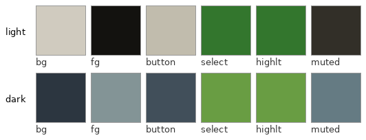
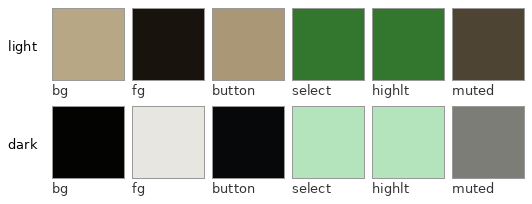
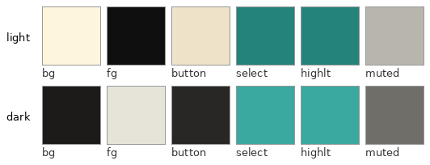
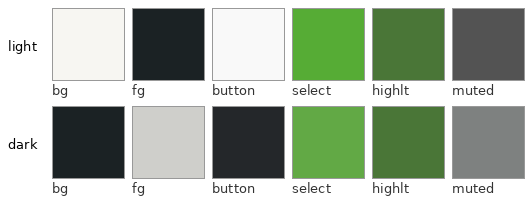
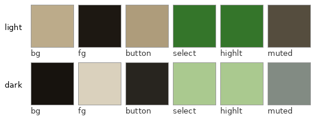

# Devs Themes

Central repo for my custom themes. Each app pulls its own **copy** from here and is free to fine-tune it independently; this repo is canonical, not hard-linked to my apps.

## Preview

| Slate | Bonepaper |
|---|---|
|  |  |

| Flexoki | Martin |
|---|---|
|  |  |

| Cypress |
|---|
|  |

Generated by `make_swatches.py` -- re-run after any palette edit to
keep these in sync.

## Families

`palettes/<family>.json` -- `slate`, `bonepaper`, `flexoki`, `martin`,
`cypress` (Bonepaper x Everforest blend; `cypress-archive.json` keeps
the pre-final values Devin wanted preserved, not a real consumer-facing
family).
Each has a `light` and `dark` mode, both with the same 8 base keys:

| key | role |
|---|---|
| `bg` | window/page background |
| `fg` | primary text |
| `button_bg` | button/control fill |
| `entry_bg` | text-input fill |
| `canvas_bg` | document/canvas background |
| `select_bg` | selection/checked-toggle fill |
| `muted_fg` | secondary/dimmed text |
| `highlight_bg` | text-highlight/TOC-highlight fill |

Some families carry extra per-consumer keys beyond the 8 (e.g.
`bonepaper.json`'s `external_link`, used by Runestone) -- consumers
whitelist to their own known shape rather than trusting the file
verbatim, since this repo is shared across apps with different needs.

`palettes/*.toml` mirrors the same data (`export_toml.py`, generated,
never hand-edited -- re-run after any JSON edit).

## Syncing

`sync_all.py <family>` propagates one family's `palettes/<family>.json`
into every real consumer -- Slate (via `slate/pull_themes.sh`), webUI
(regex-patches the live CSS custom properties), and Runestone's
bonepaper Obsidian snippet. Alacritty's terminal themes need actual
per-theme ANSI-palette design on top of the base 8 keys, so those stay
hand-built in [dotfiles](https://github.com/devinscodex/dotfiles), not
auto-synced.