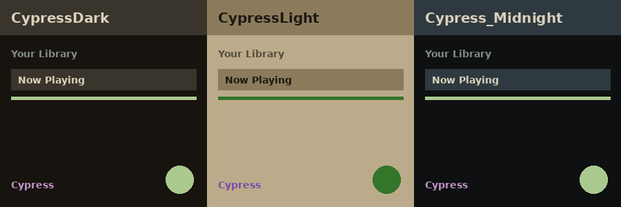

# Cypress

A Bonepaper x Everforest blend for Spicetify's [text](https://github.com/spicetify/spicetify-themes/tree/master/text)
theme. Real values sourced from
[`palettes/cypress.json`](../palettes/cypress.json), the same canonical
palette that feeds the Alacritty, Slate, and webUI Cypress themes.



## Schemes

- **CypressDark** -- warm dark-brown bg (`#17130e`), sage-green accent.
- **CypressLight** -- khaki-tan bg (`#bcab8a`), forest-green accent.
- **CypressMidnight** -- the pre-final Cypress Dark bg, a cooler
  near-black (`#0e1011`), kept alive as
  [`cypress-archive.json`](../palettes/cypress-archive.json)
  rather than lost when the warmer brown was promoted to be Cypress
  Dark itself.

## Install

Through [Spicetify Marketplace](https://github.com/spicetify/marketplace):
search "Cypress" in the Themes tab, install, then pick a scheme in the
"text" theme's color-scheme dropdown.

Or by hand:

```powershell
spicetify config current_theme text color_scheme CypressDark
spicetify apply
```

## Credit

Forked from [spicetify/spicetify-themes](https://github.com/spicetify/spicetify-themes)'
`text` theme (MIT License, © morpheusthewhite) -- `user.css` is
unmodified except for the header comment; only `color.ini`'s Cypress
schemes are new. See [LICENSE](LICENSE).
